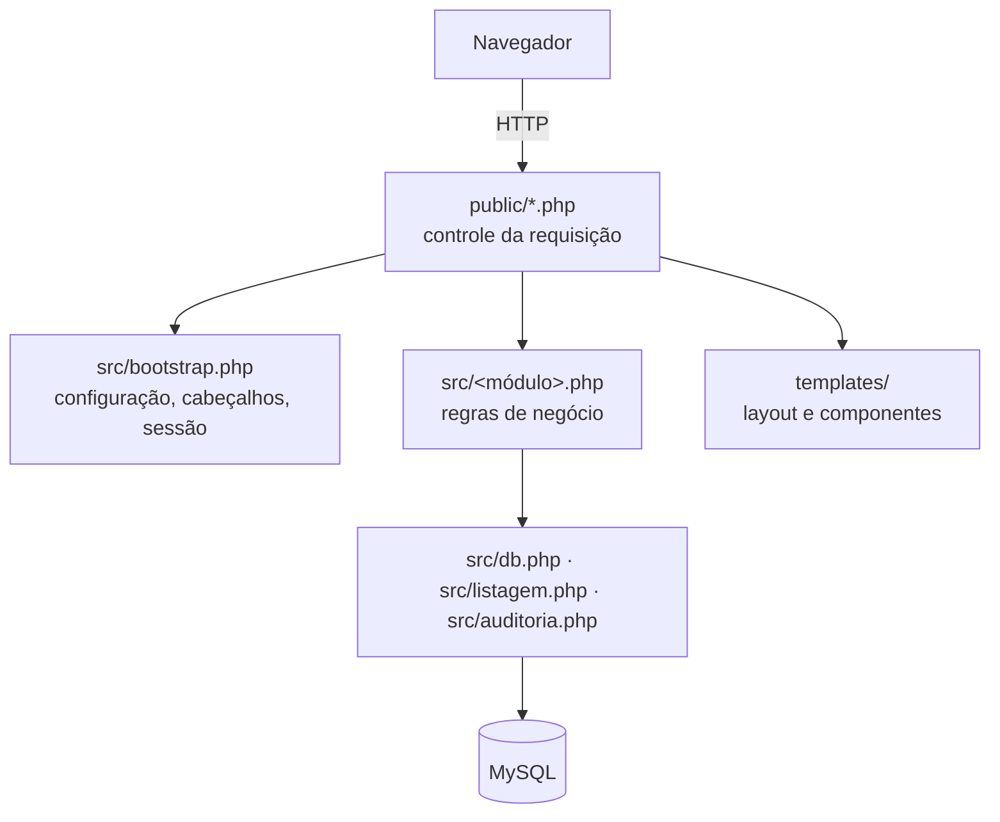

# Arquitetura

Este documento descreve como o Control está organizado, como uma requisição é processada e quais convenções o código segue. O objetivo é que alguém que nunca viu o projeto consiga localizar uma regra e alterá-la com segurança.

## Princípios

1. **Sem framework, sem dependências de runtime.** O sistema roda em um XAMPP padrão, sem Composer, e a manutenção não depende do ciclo de vida de bibliotecas de terceiros.
2. **Páginas finas, domínio em `src/`.** As páginas recebem a requisição, chamam funções de domínio e renderizam o HTML. Regras de negócio, validações e SQL ficam fora delas.
3. **O servidor é a fonte da verdade.** Toda regra de fluxo e permissão é validada no back-end. A interface só esconde o que o usuário não pode fazer.
4. **Tudo é auditável.** Toda ação que altera dados gera um registro em `logs_sistema`. As mudanças de status geram também uma movimentação na trajetória da OS.
5. **Falhas não vazam.** Erros vão para o log do Apache e o usuário vê uma mensagem genérica.

## Camadas



| Camada | Diretório | Responsabilidade |
| --- | --- | --- |
| Entrada | `public/` | Uma página por tela. Autorização, leitura do formulário, chamada ao domínio, redirecionamento e HTML |
| Domínio | `src/` | Validação, regras de fluxo, persistência e auditoria. Um arquivo por assunto |
| Infraestrutura | `src/db.php`, `src/listagem.php`, `src/helpers.php`, `src/auditoria.php` | Acesso a dados, paginação, entrada/saída HTTP e trilha de auditoria |
| Apresentação | `templates/` | Layout (cabeçalho, menu, rodapé), componentes reutilizáveis e formulários compartilhados |
| Configuração | `config/` | Parâmetros do ambiente |

Somente `public/` é acessível pela web. Os diretórios `src/`, `templates/`, `config/`, `database/` e `docs/` têm `.htaccess` com `Require all denied`.

## Ciclo de uma requisição

Todas as páginas seguem o mesmo roteiro, o padrão **Post/Redirect/Get**:

```php
require __DIR__ . '/../src/bootstrap.php';

$usuario = exigir_setor('hardware');          // 1. autorização

if (is_post()) {
    csrf_verificar();                          // 2. proteção CSRF
    try {
        equipamento_atualizar($id, $dados);    // 3. regra de negócio
        flash('sucesso', 'Equipamento salvo.');
    } catch (RuntimeException $ex) {
        flash('erro', $ex->getMessage());      // 4. erro de regra vira mensagem
    }
    redirect('equipamentos/ver.php?id=' . $id); // 5. PRG: F5 não reenvia o formulário
}

render_header('Equipamento', 'equipamentos');  // 6. renderização
// ... HTML da página ...
render_footer();
```

O `bootstrap.php` executa nesta ordem:

1. Carrega `helpers.php` e define o fuso horário a partir de `config/app.php`.
2. Desliga a exibição de erros e liga o log.
3. Envia os cabeçalhos de segurança: CSP, `X-Frame-Options`, `nosniff`, `Referrer-Policy` e `Permissions-Policy`.
4. Carrega os módulos de domínio e os templates.
5. Registra o tratador global de exceções. Ele grava no log e devolve HTTP 500 com uma mensagem amigável.
6. Inicia a sessão com o cookie restrito ao `base_url`, `HttpOnly` e `SameSite=Lax`, e verifica a inatividade.

### Tratamento de erros

| Tipo | Significado | Tratamento |
| --- | --- | --- |
| `RuntimeException` | Violação de regra de negócio, como "A OS já foi enviada à ADM" | Capturada na página e exibida como mensagem flash |
| `PDOException` e demais `Throwable` | Falha técnica | Tratador global: log no Apache, HTTP 500 e mensagem genérica |
| `acesso_negado()` / `nao_encontrado()` | Autorização ou recurso inexistente | HTTP 403 / 404 com página padrão |

As funções de validação de formulário devolvem `array<string, string>` (campo => mensagem) em vez de lançar exceção. Assim a página pode marcar cada campo com erro (`campo_erro`, `aria_erro`).

## Módulos de domínio

| Arquivo | Assunto | Funções principais |
| --- | --- | --- |
| `auth.php` | Login, sessão, setores e permissões | `tentar_login`, `login_bloqueado`, `exigir_login`, `exigir_setor`, `exigir_admin`, `senha_erro`, `sessoes_invalidar` |
| `usuarios.php` | Cadastro de usuários | `usuario_validar`, `usuario_criar`, `usuario_atualizar`, `usuario_alternar`, `usuario_excluir`, `tecnico_valido` |
| `manutencoes.php` | OS, trajetória, peças e observações | `manutencao_abrir`, `manutencao_mudar_status`, `manutencao_forcar_status`, `manutencao_excluir`, `observacao_editar`, `peca_adicionar` |
| `status.php` | Status configuráveis e papéis do sistema | `status_todos`, `status_sistema_id`, `status_criar`, `status_salvar`, `status_excluir` |
| `equipamentos.php` | Cadastro de equipamentos | `equipamento_validar`, `equipamento_criar`, `equipamento_atualizar`, `equipamento_por_codigo` |
| `atualizacoes.php` | Anúncio de novas versões | `atualizacao_criar`, `atualizacao_publicar`, `atualizacao_reanunciar`, `atualizacoes_nao_vistas`, `texto_formatado` |
| `auditoria.php` | Log do sistema | `auditar`, `diferencas`, `log_link` |
| `configuracoes.php` | Parâmetros editáveis pela interface | `config_valor`, `config_etiqueta_validar`, `config_etiqueta_salvar` |
| `graficos.php` | Dados e SVG dos gráficos do dashboard | `grafico_dados_*`, `grafico_rosca`, `grafico_linhas`, `grafico_tempo` |
| `backup.php` | Geração, listagem e retenção de backups | `backup_gerar`, `backup_lista`, `backup_arquivo` |
| `icons.php` | Ícones Lucide em SVG inline | `icon` |

## Acesso a dados

### Helpers de consulta (`src/db.php`)

A conexão PDO é única por requisição e usa `ERRMODE_EXCEPTION`, `FETCH_ASSOC` e **prepared statements nativos** (`EMULATE_PREPARES = false`). O fuso da sessão MySQL é alinhado ao do PHP.

| Função | Retorno | Uso típico |
| --- | --- | --- |
| `db_executar($sql, $params)` | `PDOStatement` | `UPDATE`/`DELETE`, `rowCount()` |
| `db_linha` | `?array` | Busca por id |
| `db_lista` | `array` | Listas |
| `db_valor` | `mixed` | `COUNT(*)`, um campo |
| `db_coluna` | `array` | Lista de ids |
| `db_pares` | `array` | Mapa chave => valor (`FETCH_KEY_PAIR`) |
| `db_inserir` | `int` | `INSERT` e retorno do id gerado |
| `marcadores($valores)` | `string` | `"?, ?, ?"` para cláusulas `IN (...)` |
| `transacao(callable)` | retorno do callable | `BEGIN`, `COMMIT` e `ROLLBACK` com relançamento da exceção |

> **Restrição:** com prepares nativos, um placeholder nomeado não pode se repetir na mesma consulta. O código usa placeholders posicionais (`?`).

### Listagens filtradas e paginadas (`src/listagem.php`)

As telas de listagem (OS, equipamentos, logs) usam a mesma construção:

```php
$filtro = (new Filtro())
    ->igual('m.status_id', $status, $status > 0)
    ->contem(['e.codigo', 'e.modelo'], $busca)
    ->periodo('m.aberta_em', $de, $ate);

$resultado = consulta_paginada(
    'm.id, e.codigo, m.aberta_em',
    'manutencoes m JOIN equipamentos e ON e.id = m.equipamento_id',
    $filtro,
    'm.id DESC'
);

render_paginacao($resultado, escolherQuantidade: true);
```

- `Filtro` ignora critérios vazios, então a página não precisa de `if` para cada filtro.
- `consulta_paginada` executa o `COUNT`, limita a página à última existente e devolve um `ResultadoPaginado` imutável.
- A quantidade por página (25, 50, 100 ou 200) fica salva na sessão, separada por tela.

### Concorrência

- **Abertura de OS:** `SELECT ... FOR UPDATE` no equipamento dentro da transação. Isso impede duas OS em andamento para o mesmo aparelho.
- **Troca de status:** `UPDATE ... WHERE id = ? AND status_id = ?` (bloqueio otimista). Se outra pessoa alterou a OS antes, nenhuma linha é afetada e o usuário recebe "A OS foi alterada por outra pessoa".

## Apresentação

### Layout (`templates/layout.php`)

- `render_header($titulo, $chaveAtiva)` abre o documento, o cabeçalho e o menu lateral conforme o setor e o perfil do usuário.
- `render_footer()` fecha o documento e exibe o aviso de atualizações.
- Os menus são declarados como dados nas constantes `MENU_HARDWARE`, `MENU_ERP` e `MENU_ADMIN`.

### Componentes (`templates/componentes.php`)

| Componente | Finalidade |
| --- | --- |
| `opcoes`, `opcoes_lista`, `select_cor` | `<option>` de selects, com o valor atual marcado |
| `campo_erro`, `aria_erro` | Mensagem de validação acessível por campo |
| `campos_filtro` | Preserva os filtros ativos em formulários GET |
| `render_paginacao` | Navegação de páginas, com seletor de quantidade e "Ir para" |
| `render_timeline` | Trajetória da OS |
| `cartao_indicador`, `selo` | Indicadores numéricos e etiquetas |
| `render_aviso_atualizacoes` | Modal pós-login ou popup de novidade |

### Estilos

- Tailwind CSS v4. O tema (cores, fontes, raios) fica em `src/input.css`, no bloco `@theme`, e segue `design-system/control/MASTER.md`. A cor primária é `#0072C6`.
- Padrões repetidos viram classes de componente em `src/input.css`: `.btn`, `.btn-primary`, `.btn-danger-outline`, `.card`, `.input`, `.label`, `.tabela`, `.selo` e `.pagina`.
- O CSS compilado (`public/assets/app.css`) é versionado, assim a implantação não exige Node.js.

### Saída segura

Todo valor dinâmico impresso no HTML passa por `e()`, que aplica `htmlspecialchars` com `ENT_QUOTES` e UTF-8. Textos com formatação (descrição de atualizações) passam por `texto_formatado()`, que escapa o conteúdo antes de aplicar a marcação mínima.

## Convenções de código

| Tema | Convenção |
| --- | --- |
| Tipagem | `declare(strict_types=1)` em `src/` e tipos em todos os parâmetros e retornos |
| Idioma | Identificadores, mensagens e banco em português, coerentes com o domínio do negócio |
| Nomes | Funções `modulo_acao` (`usuario_criar`, `status_excluir`); constantes em `MAIUSCULAS`; classes em `PascalCase` |
| SQL | Sempre com parâmetros. Nunca concatenar entrada do usuário. Listas de colunas permitidas ficam em constantes |
| Escrita | Operações com mais de uma escrita rodam em `transacao()` |
| Auditoria | Toda função que altera dados chama `auditar()`. Edições registram antes/depois com `diferencas()` |
| Comentários | Só para restrições ou decisões que o código não expressa sozinho |
| Status | Regras referem-se aos **papéis** (`STATUS_INICIAL`, `STATUS_ENVIADO_ERP`, `STATUS_RECEBIDO_ERP`), nunca a ids ou nomes, que o administrador pode alterar |

## Decisões de projeto

| Decisão | Motivo |
| --- | --- |
| PHP puro em vez de framework | Implantação em XAMPP sem Composer, curva de aprendizado baixa para a equipe interna e nenhuma dependência para atualizar |
| Funções em vez de classes no domínio | Domínio pequeno e procedural por natureza. Classes só onde há estado (`Filtro`, `ResultadoPaginado`) |
| Gráficos em SVG gerado no servidor | Funcionam sem internet e sem biblioteca JavaScript, e respeitam a CSP |
| Código de barras gerado no navegador | Impressão direta pelo diálogo do sistema, compatível com qualquer impressora térmica com driver |
| Status configuráveis com papéis fixos | O setor renomeia e cria etapas livremente sem quebrar as regras do fluxo |
| Migrações no `setup.php` | Uma instalação antiga é atualizada com um único comando, sem ferramenta extra |
