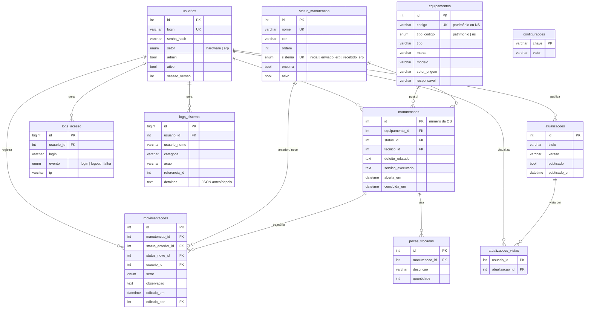

# Banco de Dados

MySQL ou MariaDB com engine **InnoDB** (transações e chaves estrangeiras) e charset **`utf8mb4_unicode_ci`**. A estrutura completa está em [`database/schema.sql`](../database/schema.sql).

## Diagrama entidade-relacionamento



## Tabelas

| Tabela | Finalidade | Observações |
| --- | --- | --- |
| `usuarios` | Contas de acesso | `senha_hash` usa `password_hash` (bcrypt). Incrementar `sessao_versao` derruba as sessões abertas do usuário |
| `equipamentos` | Aparelhos identificados por patrimônio ou número de série | `codigo` é único e normalizado em maiúsculas, sem espaços |
| `status_manutencao` | Status configuráveis da OS | `sistema` marca os três papéis fixos (únicos). `encerra` define se a OS está em andamento |
| `manutencoes` | Ordens de serviço | O `id` é o número da OS. `concluida_em` é preenchida ao encerrar e limpa ao reabrir |
| `movimentacoes` | Trajetória: trocas de status e observações | Observação avulsa: `status_anterior_id = status_novo_id` |
| `pecas_trocadas` | Peças usadas em cada OS | Excluídas em cascata com a OS |
| `logs_acesso` | Logins, saídas e falhas de autenticação | `login` guarda o texto digitado, inclusive de usuários inexistentes. É a base do bloqueio de força bruta |
| `logs_sistema` | Auditoria de todas as ações | `usuario_nome` guarda o nome da época, para o log sobreviver à exclusão do usuário. `detalhes` guarda o JSON com antes/depois |
| `atualizacoes` | Anúncios de novas versões | `publicado_em` marca o início da janela de 24 horas do popup |
| `atualizacoes_vistas` | Quem já viu cada anúncio | Chave composta, que garante o aviso pós-login uma única vez |
| `configuracoes` | Parâmetros editáveis pela interface | Chave/valor: tamanho e título da etiqueta |

## Integridade referencial

| Relação | Ao excluir o pai |
| --- | --- |
| `manutencoes` → `equipamentos`, `status_manutencao` | Bloqueado (`RESTRICT`) |
| `pecas_trocadas`, `movimentacoes` → `manutencoes` | Cascata |
| `manutencoes.tecnico_id`, `movimentacoes.editado_por`, logs e `atualizacoes.criado_por` → `usuarios` | `SET NULL` |
| `movimentacoes.usuario_id` → `usuarios` | Bloqueado. Por isso, usuário com histórico só pode ser desativado |
| `atualizacoes_vistas` → `usuarios`, `atualizacoes` | Cascata |

## Índices

Além das chaves primárias, únicas e estrangeiras, há índices para as consultas mais frequentes:

- `manutencoes (aberta_em)`, `movimentacoes (criado_em)`: listagens por período e dashboard.
- `equipamentos (tipo)`, `equipamentos (setor_origem)`: filtros da listagem.
- `logs_acesso (criado_em)`, `logs_acesso (usuario_id, criado_em)`: filtros dos logs e cálculo do bloqueio.
- `logs_sistema (criado_em)`, `(categoria, criado_em)`, `(usuario_id, criado_em)`: filtros dos logs.
- `atualizacoes (publicado, publicado_em)`: anúncio em destaque.

## Dados iniciais

O `schema.sql` insere, com `INSERT IGNORE` (seguro para reexecução):

- os oito status padrão, incluindo os três de sistema;
- as configurações padrão da etiqueta (40 x 25 mm, título "Hardware").

O `setup.php` cria o usuário `admin` somente se a tabela `usuarios` estiver vazia.

## Migrações

O `database/setup.php` é a ferramenta de instalação **e** de migração. Ele:

1. cria o banco, se não existir;
2. executa o `schema.sql` (todas as instruções são `CREATE TABLE IF NOT EXISTS` / `INSERT IGNORE`);
3. aplica as migrações incrementais, cada uma protegida por uma verificação de existência em `information_schema`;
4. cria o administrador inicial, se necessário.

Reexecutá-lo é sempre seguro.

### Como adicionar uma migração

1. Atualize o `CREATE TABLE` em `schema.sql`, para que instalações novas já nasçam com a estrutura final.
2. Acrescente ao `setup.php` um bloco protegido, para que instalações existentes recebam a alteração:

```php
if (!coluna_existe($pdo, 'equipamentos', 'localizacao')) {
    $pdo->exec('ALTER TABLE equipamentos ADD localizacao VARCHAR(120) NULL AFTER responsavel');
    echo "Atualização: localização adicionada aos equipamentos.\n";
}
```

3. Faça um backup antes de rodar em produção (veja [OPERACAO.md](OPERACAO.md)).
