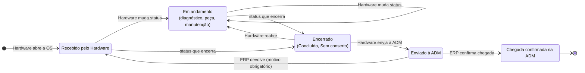

# Fluxo da Ordem de Serviço

Este documento descreve os setores, as permissões e as regras que governam a vida de uma OS, desde a entrada do aparelho no Hardware até a confirmação de chegada na ADM.

## Setores e perfis

Cada usuário pertence a **um setor** e pode, além disso, ser **administrador**.

| Perfil | Página inicial | Pode |
| --- | --- | --- |
| **Automação Hardware** | Dashboard | Cadastrar e editar equipamentos, abrir OS, mudar status, registrar diagnóstico, serviço, peças e observações, imprimir etiquetas e enviar à ADM |
| **Automação ERP** | Confirmar chegada | Bipar ou digitar o código, confirmar a chegada na ADM, devolver ao Hardware com motivo e registrar observações |
| **Administrador** (em qualquer setor) | A do seu setor | Tudo o que os dois setores fazem, mais usuários, status, configurações, logs, backup, anúncios e a **Zona do administrador** |

> Quando um administrador usa uma página de outro setor, ele age **como aquele setor**: as regras de fluxo e o setor gravado na trajetória são os da página (`exigir_setor`).

Regras de cadastro de usuários:

- Sempre existe pelo menos um administrador ativo. O último não pode perder o perfil, ser desativado nem ser excluído.
- Ninguém desativa ou exclui o próprio usuário.
- Um usuário que já aparece no histórico (movimentações ou como técnico de OS) não pode ser excluído, só desativado. Assim a trajetória continua íntegra.

## Status e papéis

Os status são cadastrados na tela **Status**: nome, cor, ordem, "encerra o serviço" e ativo. Três deles têm um **papel de sistema** fixo, usado pelas regras do fluxo. Esses três podem ser renomeados, mas não excluídos.

| Papel (constante) | Status padrão | Significado |
| --- | --- | --- |
| `STATUS_INICIAL` | Recebido pelo Hardware | Toda OS nasce aqui. É também o destino de uma devolução pelo ERP |
| `STATUS_ENVIADO_ERP` | Enviado à ADM | O aparelho saiu do Hardware e aguarda a confirmação do ERP |
| `STATUS_RECEBIDO_ERP` | Chegada confirmada na ADM | Fim do ciclo |

Os demais status (Em diagnóstico, Aguardando peça, Em manutenção, Concluído, Sem conserto...) são livres. A marcação **Encerra o serviço** decide se a OS ainda está **em andamento** no Hardware.

- Um status que já foi usado em alguma OS fica no histórico: pode ser desativado, mas não excluído.
- Status inativos não aparecem para escolha, mas continuam sendo exibidos nas OS antigas.

## Diagrama de estados

## Regras de transição

As regras são aplicadas no servidor por `manutencao_mudar_status()` (`src/manutencoes.php`).

### Hardware

| Regra | Mensagem |
| --- | --- |
| Não altera uma OS enviada à ADM ou com chegada confirmada | "Esta OS já foi enviada à ADM e não pode ser alterada pelo Hardware." |
| Não confirma chegada na ADM | "Somente a Automação ERP confirma a chegada na ADM." |
| Só envia à ADM a partir de um status que **encerra** o serviço | "Mude a OS para um status que encerra o serviço (ex.: Concluído) antes de enviar à ADM." |
| Não escolhe o status atual | "A OS já está neste status." |
| Diagnóstico, serviço, técnico e peças só podem ser editados enquanto a OS não foi enviada à ADM | "Esta OS já foi enviada à ADM e não pode ser alterada." |

### ERP

| Regra | Mensagem |
| --- | --- |
| Só atua em OS no papel **Enviado à ADM** e só pode confirmar ou devolver | "A Automação ERP só pode confirmar a chegada ou devolver aparelhos enviados à ADM." |
| A devolução exige motivo | "Informe o motivo da devolução ao Hardware." |

### Regras gerais

- **Uma OS em andamento por equipamento.** Não é possível abrir uma nova OS, nem reabrir uma encerrada, se o aparelho já tem outra em andamento. A abertura trava o equipamento com `SELECT ... FOR UPDATE`.
- **Data de conclusão.** É preenchida quando a OS passa de um status em andamento para um que encerra, e limpa quando é reaberta.
- **Concorrência.** Se duas pessoas alteram a mesma OS ao mesmo tempo, a segunda recebe "A OS foi alterada por outra pessoa. Recarregue a página."
- **Técnico responsável.** Deve ser um usuário ativo do setor Hardware.

## Zona do administrador

Na tela da OS, o administrador tem ações que **ignoram as regras de fluxo**. As reversões de status exigem motivo e ficam registradas na trajetória com o nome do administrador. Todas as ações ficam no log do sistema.

| Ação | Efeito |
| --- | --- |
| **Desfazer última mudança** | Volta a OS para o status anterior à última troca |
| **Definir qualquer status** | Coloca a OS em qualquer status |
| **Excluir OS** | Remove a OS, as peças e a trajetória. O equipamento continua cadastrado e a exclusão fica no log do sistema |

A regra de "uma OS em andamento por equipamento" continua valendo mesmo para o administrador.

## Trajetória e observações

Toda troca de status gera uma linha em `movimentacoes` com status anterior, status novo, usuário, setor, data e observação opcional. Uma observação avulsa é registrada como movimentação com status anterior igual ao novo.

- A trajetória aparece na tela da OS, na tela do equipamento (todas as OS do aparelho) e na consulta do ERP.
- Uma observação pode ser editada **pelo autor ou por um administrador**. A trajetória passa a mostrar "Editada por ... em ...", e o log do sistema guarda o texto anterior e o novo.

## Do aparelho à etiqueta

1. O Hardware bipa ou digita o patrimônio ou número de série na busca. Se o equipamento existe, abre a ficha dele; se não, abre o formulário de nova OS já com o código preenchido.
2. Na abertura, o equipamento é cadastrado (se for novo) e a OS nasce no status inicial.
3. A etiqueta com Code128 é impressa pela tela do equipamento.
4. O aparelho segue o fluxo até ser enviado à ADM.
5. O ERP bipa a etiqueta em **Confirmar chegada**, confere a trajetória e confirma ou devolve.
